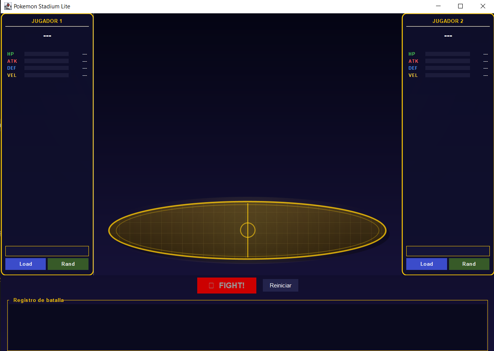
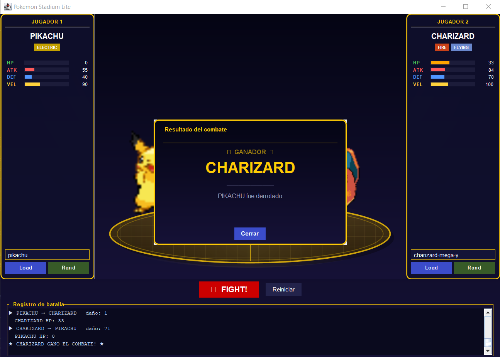

# Pokemon Stadium Lite

## ¿Qué es esto?

Es una aplicación de escritorio hecha en Java que simula un combate entre dos Pokemon. La idea es que cada jugador elige un Pokemon buscándolo por nombre o cargando uno al azar, y luego pueden hacerlos pelear. El programa se conecta a una API real de Pokemon para obtener los datos, así que los stats, sprites y tipos que aparecen son los oficiales.

Se realiza como proyecto para aplicar conceptos de programación orientada a objetos, interfaces gráficas en Java y consumo de APIs REST.

---

## ¿Cómo se usa?

1. Ejecutar la clase `PokemonStadiumLite` desde IntelliJ
2. En el panel izquierdo escribir el nombre de un Pokemon (por ejemplo `pikachu` o `charizard`) y darle **Load**, o usar **Rand** para cargar uno al azar
3. Hacer lo mismo en el panel derecho
4. Cuando los dos estén cargados se habilita el botón **FIGHT!**
5. Darle Fight! y ver cómo se desarrolla el combate en el log de abajo
6. El botón **Limpiar log** limpia el historial de la batalla

---

## Clases del proyecto

### `Pokemon.java`
Es el modelo de datos. Guarda toda la información de un Pokemon: nombre, lista de tipos, HP, ataque, defensa, velocidad, HP actual durante el combate, URL del sprite e imagen descargada. Tiene getters/setters y un método `getTiposTexto()` que devuelve los tipos como un string separado por comas. El setter de `hpActual` no permite valores negativos gracias a un `Math.max(0, ...)`.

### `PokeApiClient.java`
Es la clase que se conecta a la PokeAPI (`pokeapi.co`). Usa el `HttpClient` nativo de Java (disponible desde Java 11) para hacer una petición GET al endpoint `/pokemon/{nombre}`. Parsea el JSON de respuesta con la librería `org.json` y extrae nombre, tipos y stats base. Intenta obtener primero el sprite animado de la generación V (GIF de Black/White); si no existe para ese Pokemon, cae al sprite estático frontal. También descarga la imagen del sprite y la guarda directamente en el objeto `Pokemon`.

### `Battle.java`
Contiene toda la lógica del combate. Corre en un hilo separado (`Thread daemon`) para que la interfaz gráfica no se congele mientras está peleando. El flujo es:
- El Pokemon con mayor velocidad ataca primero (empate se resuelve al azar)
- Calcula daño con: `daño = (ATK × rand) - (DEF × rand)`, mínimo 1
- Hay 10% de probabilidad de golpe crítico (daño × 1.5)
- Se aplica modificador de efectividad de tipos (agua > fuego > planta, etc.) con ×1.3 o ×0.7
- Alterna los turnos hasta que un Pokemon llega a 0 HP
- Pausa de 1200ms entre turnos para que sea legible
- Notifica todos los eventos a través del `BattleListener`

### `BattleListener.java`
Es una interfaz con tres métodos que `Battle` llama durante el combate:
- `onTurn()`: cuando ocurre un ataque, pasa el atacante, defensor, daño, si fue crítico y el modificador de tipo
- `onHpChanged()`: cuando el HP de algún Pokemon cambia
- `onBattleEnded()`: cuando termina el combate, con el nombre del ganador

Usamos esto para desacoplar la lógica del combate de la interfaz gráfica. `Battle` no sabe nada de Swing; solo notifica. Eso es básicamente el patrón **Observer**.

### `SoundManager.java`
Gestiona el audio de la aplicación con dos enfoques: para el grito de cada Pokémon (`playCry`), descarga el MP3 oficial desde Pokemon Showdown y lo decodifica con `mp3spi` vía `javax.sound.sampled`; para los eventos del combate (inicio, victoria), genera ondas sinusoidales directamente en memoria con un bucle matemático, aplica un envelope de fade-in/fade-out para que no suene brusco, y lo reproduce como audio PCM. Todo corre en hilos daemon para no bloquear la UI.

### `PokemonStadiumLite.java`
Es la clase principal y la más extensa. Extiende `JFrame` y tiene toda la interfaz gráfica. Lo más importante que hace:

- **Arena pintada**: tiene una inner class `PanelArena` que sobreescribe `paintComponent` y dibuja el fondo del coliseo con `Graphics2D`: gradientes, una plataforma oval, cuadrícula, línea divisoria y efectos de brillo
- **Sprites flotantes**: un `javax.swing.Timer` dispara cada 50ms y actualiza un offset en Y usando `Math.sin()`, haciendo que cada sprite flote suavemente. Los dos Pokemon flotan en fases opuestas para que se vea más dinámico
- **Stats en lista**: HP, ATK, DEF y VEL tienen cada uno su propio `JProgressBar` con color diferente; el de HP se actualiza en tiempo real durante el combate
- **Badges de tipo**: pequeñas etiquetas con color de fondo según el tipo del Pokemon
- **`SwingWorker`**: carga el Pokemon desde la API en segundo plano para no bloquear la UI
- **Anonymous inner class**: implementa `BattleListener` y todas las actualizaciones de componentes se envían con `SwingUtilities.invokeLater` para respetar el hilo de Swing (EDT)

---

## Tecnologías

| Cosa | Para qué la uso |
|---|---|
| Java 23 | Lenguaje base |
| Java Swing | Interfaz gráfica (ventanas, botones, barras, etc.) |
| `java.net.http.HttpClient` | Peticiones HTTP a la PokeAPI |
| `org.json` (v20240303) | Parsear el JSON que devuelve la API |
| `javax.sound.sampled` | Generar y reproducir sonidos sintetizados |
| Maven | Gestión de dependencias y compilación |

---

## Estructura de archivos

```
src/main/java/
├── PokemonStadiumLite.java   ← Ventana principal, UI y animaciones
├── Pokemon.java              ← Modelo de datos
├── PokeApiClient.java        ← Conexión a la PokeAPI
├── Battle.java               ← Lógica del combate (en hilo separado)
├── BattleListener.java       ← Interfaz Observer del combate
└── SoundManager.java         ← Sonidos sintetizados en tiempo real
```

---

## Cómo compilar y ejecutar

Desde IntelliJ: abrir el proyecto, esperar que Maven descargue las dependencias, y ejecutar `PokemonStadiumLite`.

Con Maven desde la terminal:

```bash
# Compilar
mvn compile

# Ejecutar
mvn exec:java

# Empaquetar como JAR ejecutable con todas las dependencias incluidas
mvn package
java --enable-preview -jar target/pokemon-stadium-lite-1.0-jar-with-dependencies.jar
```

---

## Capturas de pantalla






---

## Notas

- Requiere conexión a internet para consultar la PokeAPI y descargar los sprites
- Se puede buscar por nombre en inglés o por número de Pokedex (ejemplo: `25` para Pikachu)
- Los gritos de los Pokémon se descargan de Pokemon Showdown; los sonidos de eventos (inicio, victoria) son tonos sintéticos generados en memoria
